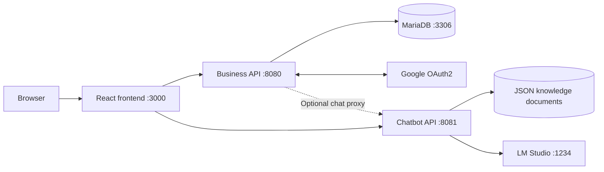

# [Project CRI — TPME Investment Support Platform](https://github.com/its-Medd/project_cri)

**A bilingual investment support platform for TPMEs in the Laâyoune–Sakia El Hamra region.**

Project CRI brings together investment information, eligibility checks, grant simulations, a guided questionnaire, a personal account area, an administrator dashboard, and a document-informed AI assistant.

TPME refers to *Très Petites, Petites et Moyennes Entreprises*. The application presents the regional investment support scheme through a French and Arabic interface.

> This README describes the source at commit [`8ae55c0`](https://github.com/its-Medd/project_cri/commit/8ae55c0). Configuration and behavior below are based on the implementation; the application was not launched as part of preparing this documentation.

## Table of contents

- [Overview](#overview)
- [Features](#features)
- [Architecture](#architecture)
- [Technology stack](#technology-stack)
- [Repository structure](#repository-structure)
- [Prerequisites](#prerequisites)
- [Local installation](#local-installation)
- [Environment configuration](#environment-configuration)
- [Application routes](#application-routes)
- [API reference](#api-reference)
- [Chatbot and document management](#chatbot-and-document-management)
- [Data and authentication](#data-and-authentication)
- [Simulation behavior](#simulation-behavior)
- [Build and testing](#build-and-testing)
- [Deployment](#deployment)
- [Troubleshooting](#troubleshooting)
- [Known limitations](#known-limitations)
- [Contributing](#contributing)
- [Maintainer and license](#maintainer-and-license)

## Overview

The repository contains three independently started applications:

| Application | Directory | Responsibility | Default local address |
| --- | --- | --- | --- |
| Web frontend | `dispo-tpme-front/` | Public pages, simulations, authentication, questionnaire, profile, dashboard, chat widget | `http://localhost:3000` |
| Business API | `dispo-tpme-back/` | Authentication, database persistence, user history, administration, optional chat proxy | `http://localhost:8080` |
| Chatbot API | `chatbot/` | Document matching, prepared answers, local model calls, streaming | `http://localhost:8081` |

The business API uses MariaDB. The chatbot stores its knowledge documents in a JSON file and connects to an OpenAI-compatible local model server such as LM Studio.

## Features

### Public experience

- Regional investment support information and downloadable reference documents.
- Eligibility form covering company and investment information.
- Investment grant simulator with employment, territorial, and priority activity components.
- Dossier preparation checklist with completion progress.
- French and Arabic translations through i18next; French is the initial and fallback language.
- Floating assistant available across the application.

### Registered users

- Email/password registration and login.
- Google OAuth2 login.
- Authenticated investment questionnaire.
- Saved eligibility checks and questionnaire submissions.
- Personal profile and access to user-associated records.
- Access token renewal using a refresh cookie.

### Administration

- Separate administrator login page.
- Role-protected dashboard API.
- Access to questionnaire submissions and grant calculation records.

### Chatbot

- Document selection using keyword and category matching.
- Prepared responses for selected questions, with model-assisted answers for other supported queries.
- JSON document storage and document CRUD endpoints.
- Standard JSON chat responses and a server-sent events streaming endpoint.
- Fallback replies when model calls fail.

## Architecture



The current chat widget uses `chatService` in `dispo-tpme-front/src/api.js` to call the chatbot directly. The business API also exposes `POST /api/chat`, but the widget does not use that proxy by default.

The chatbot uses Spring HTTP clients directly. Its configuration properties use the `spring.ai.openai.*` prefix, but its Maven configuration does not include Spring AI, embeddings, or a vector database.

## Technology stack

| Layer | Technologies declared in the repository |
| --- | --- |
| Frontend | React 19.2.4, React Router 6.30.3, React Scripts 5.0.1 |
| HTTP client | Axios 1.16.0 |
| Localization | i18next 23.2.3, react-i18next 13.2.2 |
| UI | CSS Modules, shared CSS, Font Awesome |
| Business backend | Java 21, Spring Boot 3.5.12, Spring Web, Spring Security |
| Persistence | Spring Data JPA, Hibernate, MariaDB JDBC driver |
| Authentication | JJWT 0.12.5, BCrypt, Spring OAuth2 Client |
| Chatbot backend | Java 21, Spring Boot 3.3.4, Spring Web, WebFlux HTTP client |
| Local inference | LM Studio OpenAI-compatible API |
| Build and tests | npm, Maven, React Testing Library, Spring Boot Test |

Frontend package versions above follow the dependency declarations; `package-lock.json` records resolved versions.

## Repository structure

```text
project_cri/
├── chatbot/
│   ├── data/documents.json          # Persisted chatbot knowledge
│   ├── rag-documents/               # Reference assets; historical folder name
│   ├── pom.xml
│   └── src/main/
│       ├── java/com/tpme/chatbot/
│       │   ├── config/
│       │   ├── controller/          # Chat and document HTTP endpoints
│       │   ├── dto/
│       │   ├── model/
│       │   └── service/             # Reply generation and document matching
│       └── resources/
│           ├── application.properties
│           ├── chatbot-data-source.md
│           └── seed-documents.json
├── dispo-tpme-back/
│   ├── .mvn/                       # Maven wrapper configuration
│   ├── mvnw / mvnw.cmd
│   ├── pom.xml
│   ├── Procfile
│   ├── system.properties
│   └── src/
│       ├── main/java/Cri/Tpme/Back_end/
│       │   ├── chatbot/            # Optional chatbot proxy
│       │   ├── config/
│       │   ├── controller/
│       │   ├── dto/
│       │   ├── entity/
│       │   ├── exception/
│       │   ├── repository/
│       │   ├── security/
│       │   └── service/
│       ├── main/resources/application.properties
│       └── test/
└── dispo-tpme-front/
    ├── .env.example
    ├── package.json
    ├── package-lock.json
    ├── public/
    │   ├── docs/                   # Downloadable PDF/DOCX references
    │   └── videos/
    └── src/
        ├── Components/
        ├── Styles/
        ├── assets/
        ├── context/AuthContext.jsx
        ├── data/index.js
        ├── api.js
        ├── i18n.js
        └── App.js
```

## Prerequisites

- Git.
- JDK 21, with `JAVA_HOME` pointing to that JDK.
- Maven for the chatbot, which does not include its own Maven wrapper.
- Node.js and npm compatible with the committed frontend dependencies. The repository does not pin a Node version.
- MariaDB reachable on port `3306`, as used by the default JDBC URL.
- Google OAuth2 client credentials for Google sign-in. The backend configuration expects both credential environment variables to be defined.
- LM Studio and a loaded local model for model-generated chatbot answers. Prepared and fallback answers can still be returned without successful inference.

## Local installation

The examples below use **PowerShell**. Keep separate terminals open for each service. Environment variables set with `$env:...` apply to the current terminal and child processes.

### 1. Clone the repository

```powershell
git clone https://github.com/its-Medd/project_cri.git
cd project_cri
```

### 2. Prepare MariaDB

Run the following SQL as a database administrator. Replace the example password before use.

```sql
CREATE DATABASE project_cri
  CHARACTER SET utf8mb4
  COLLATE utf8mb4_unicode_ci;

CREATE USER 'cri_app'@'localhost' IDENTIFIED BY 'replace-with-a-local-password';
GRANT ALL PRIVILEGES ON project_cri.* TO 'cri_app'@'localhost';
```

These grants assume a local database connection. Adjust the database account host when running the backend on another machine or in a container.

Hibernate is configured with `ddl-auto=update`, so the backend creates or updates application tables at startup. The repository does not provide a versioned database migration workflow.

### 3. Configure and start the business API

From the repository root:

```powershell
cd dispo-tpme-back

$env:DB_HOST = "localhost"
$env:DB_NAME = "project_cri"
$env:DB_USER = "cri_app"
$env:DB_PASS = "replace-with-a-local-password"

# Generate a Base64-encoded 64-byte JWT signing secret.
$jwtBytes = [byte[]]::new(64)
[System.Security.Cryptography.RandomNumberGenerator]::Fill($jwtBytes)
$env:JWT_SECRET = [Convert]::ToBase64String($jwtBytes)

$env:GOOGLE_CLIENT_ID = "your-google-client-id"
$env:GOOGLE_CLIENT_SECRET = "your-google-client-secret"
$env:OAUTH2_REDIRECT_URI = "http://localhost:3000/oauth2/redirect"
$env:ALLOWED_ORIGINS = "http://localhost:3000"
$env:CHATBOT_URL = "http://localhost:8081"

.\mvnw.cmd spring-boot:run
```

Use the same JWT secret across restarts if existing access tokens should remain valid. Store it securely in your local environment configuration rather than committing it.

For Google OAuth2, configure this authorized callback URI in the Google client:

```text
http://localhost:8080/login/oauth2/code/google
```

The Google callback goes to the backend. `OAUTH2_REDIRECT_URI` is the separate frontend destination after authentication.

On macOS/Linux, use equivalent `export` commands and `./mvnw spring-boot:run`.

### 4. Configure LM Studio

1. Load a model supported by your local LM Studio installation.
2. Start its OpenAI-compatible server on port `1234`.
3. Confirm the API base URL is `http://localhost:1234/v1`.
4. Set `LM_STUDIO_MODEL` to the exact model identifier served by your installation.

The current configured default is `qwen/qwen3-4b-2507`. Older chatbot documentation refers to Gemma; `application.properties` is the source for the current default.

### 5. Start the chatbot

In a new terminal, from the repository root:

```powershell
cd chatbot
$env:LM_STUDIO_MODEL = "qwen/qwen3-4b-2507"
$env:ALLOWED_ORIGINS = "http://localhost:3000,http://localhost:8080"
mvn spring-boot:run
```

By default, the service listens on `8081` and uses `./data/documents.json` relative to its working directory. Run it from `chatbot/` to use the repository's existing data file.

### 6. Start the frontend

In another terminal, from the repository root:

```powershell
cd dispo-tpme-front
Copy-Item .env.example .env
```

Set the following values in `.env`:

```dotenv
REACT_APP_API_URL=http://localhost:8080/api
REACT_APP_CHATBOT_URL=http://localhost:8081/api
```

Then install and start:

```powershell
npm ci
npm start
```

Open [the local frontend](http://localhost:3000).

The `/api` suffix is required in both frontend API base URLs. Restart the development server after changing `.env`.

### 7. Check the main flows

1. Open the homepage and switch between French and Arabic.
2. Register a user and sign in.
3. Complete an eligibility check and the authenticated questionnaire.
4. Open the profile and inspect saved history.
5. Run a grant simulation.
6. Open the assistant and send a TPME-related question.
7. Sign in through `/admin/login` and inspect the dashboard.

On a fresh database, `DataInitializer` creates the following development administrator if its email does not already exist:

```text
Email:    admin@cri.local
Password: admin123
```

Replace this seeded credential and revise the initializer before exposing the application publicly. There is no environment-based administrator password setting in the current implementation.

## Environment configuration

### Frontend

| Variable | Default in code | Purpose |
| --- | --- | --- |
| `REACT_APP_API_URL` | `http://localhost:8080/api` | Business API base URL |
| `REACT_APP_CHATBOT_URL` | `http://localhost:8081/api` | Direct chatbot API base URL |

React Scripts embeds these values in the frontend build. They are public configuration and must not contain secrets. The provided `.env.example` mentions a development proxy, but the current `package.json` has no `proxy` field; `src/api.js` uses the explicit defaults above.

### Business API

| Variable | Default | Purpose |
| --- | --- | --- |
| `DB_HOST` | Required | MariaDB host |
| `DB_NAME` | Required | Database name |
| `DB_USER` | Required | Database username |
| `DB_PASS` | Required | Database password |
| `JWT_SECRET` | Required | Base64 JWT signing secret |
| `GOOGLE_CLIENT_ID` | Required by configuration | Google OAuth2 client ID |
| `GOOGLE_CLIENT_SECRET` | Required by configuration | Google OAuth2 client secret |
| `OAUTH2_REDIRECT_URI` | `http://localhost:3000/oauth2/redirect` | Frontend destination after OAuth2 |
| `ALLOWED_ORIGINS` | `http://localhost:3000` | Comma-separated CORS origins |
| `PORT` | `8080` | HTTP listening port |
| `CHATBOT_URL` | `http://localhost:8081` | Chatbot address used by the backend proxy |
| `REFRESH_COOKIE_SECURE` | `false` | HTTPS-only refresh cookie flag |
| `REFRESH_COOKIE_SAME_SITE` | `Lax` | Refresh cookie SameSite policy |

The default JDBC URL fixes port `3306`. To use a different connection string, override `SPRING_DATASOURCE_URL` with a complete MariaDB JDBC URL.

### Chatbot API

| Variable | Default | Purpose |
| --- | --- | --- |
| `LM_STUDIO_MODEL` | `qwen/qwen3-4b-2507` | Model ID used for inference |
| `ALLOWED_ORIGINS` | `http://localhost:8080,http://localhost:3000` | Comma-separated allowed origins |
| `DOCUMENTS_STORAGE_PATH` | `./data/documents.json` | Writable document storage file |
| `DOCUMENTS_MAX_CONTEXT_CHARS` | `3500` | Maximum document context length |

Other values in `chatbot/src/main/resources/application.properties` include port `8081`, inference temperature `0.2`, and a maximum of `700` output tokens. Spring Boot environment overrides such as `SERVER_PORT`, `SPRING_AI_OPENAI_BASE_URL`, and `SPRING_AI_OPENAI_API_KEY` can adapt the service to another model server.

The two Java applications are separate processes. Their `ALLOWED_ORIGINS` values can differ.

## Application routes

| Route | Screen or behavior |
| --- | --- |
| `/` | Homepage |
| `/eligibilite` | Eligibility checker |
| `/simulateur` | Grant simulator |
| `/dossier` | Document checklist and dossier guidance |
| `/questionnaire` | Questionnaire protected by `PrivateRoute` |
| `/visitorlogin` | User login |
| `/register` | Registration |
| `/profile` | Personal profile |
| `/oauth2/redirect` | OAuth2 callback handler in the frontend |
| `/admin/login` | Administrator login |
| `/dashboard` | Dashboard protected by `AdminRoute` |
| `/login`, `/espace` | Redirect to `/visitorlogin` |
| `/etapes`, `/cri` | Redirect to the homepage |
| Unknown paths | Redirect to the homepage |

## API reference

Paths in the next two tables are relative to the business API host, normally `http://localhost:8080`.

### Authentication

| Method | Endpoint | Access / purpose |
| --- | --- | --- |
| `POST` | `/api/auth/register` | Public registration |
| `POST` | `/api/auth/login` | Public user login |
| `POST` | `/api/auth/admin/login` | Public login entry point for administrators |
| `POST` | `/api/auth/refresh` | Refresh using the configured cookie |
| `POST` | `/api/auth/logout` | Authenticated logout |
| `GET` | `/api/auth/me` | Current authenticated user |
| `GET` | `/oauth2/authorization/google` | Start Google OAuth2 login |

Login body:

```json
{
  "email": "user@example.com",
  "password": "your-password"
}
```

Authenticated API requests use:

```http
Authorization: Bearer <access-token>
```

The frontend sends requests with credentials enabled so the browser can send the refresh cookie.

### Business records and administration

| Method | Endpoint | Access / purpose |
| --- | --- | --- |
| `POST` | `/api/public/dossiers` | Public dossier record submission |
| `POST` | `/api/public/prime-calculations` | Public persistence of a simulation result |
| `GET` | `/api/user/dossiers` | Authenticated user's dossier records |
| `POST` | `/api/user/eligibility-checks` | Save an authenticated user's check |
| `GET` | `/api/user/eligibility-checks` | Read the user's check history |
| `POST` | `/api/user/questionnaire-submissions` | Save a questionnaire |
| `GET` | `/api/user/questionnaire-submissions` | Read the user's questionnaires |
| `GET` | `/api/employee/dashboard` | Administrator dashboard data |
| `GET` | `/api/employee/questionnaire-submissions` | Administrator submission listing |
| `GET` | `/api/employee/prime-calculations` | Administrator calculation listing |
| `POST` | `/api/chat` | Public proxy to the chatbot service |

The `/api/employee/*` methods above enforce `ADMIN` through method-level authorization. User identity for protected history endpoints comes from the authenticated principal.

These tables describe implemented controller mappings. Some helpers in `src/api.js`, including `/api/demandes/*` and `/api/cri`, do not have matching controllers in the current backend.

## Chatbot and document management

### Request flow

```text
Question
  → query classification / prepared reply when available
  → keyword and category document selection
  → bounded prompt context
  → LM Studio chat completion when needed
  → reply or fallback answer
```

There is no active embedding pipeline, vector store, or automatic PDF ingestion. The `rag-documents/` directory is a reference asset folder; putting a PDF there does not automatically make it searchable by the assistant.

### Endpoints

These paths are served by the chatbot host, normally `http://localhost:8081`.

| Method | Endpoint | Purpose |
| --- | --- | --- |
| `POST` | `/api/chat` | JSON chat response |
| `POST` | `/api/chat/stream` | Server-sent events response |
| `GET` | `/api/chat/health` | Chatbot health response |
| `GET` | `/documents` | List documents |
| `POST` | `/documents` | Create a document |
| `PUT` | `/documents/{id}` | Update a document |
| `DELETE` | `/documents/{id}` | Delete a document |

Example PowerShell request:

```powershell
$chatBody = @{ message = "Quelles sont les primes disponibles pour les TPME ?" } | ConvertTo-Json
Invoke-RestMethod -Method Post `
  -Uri "http://localhost:8081/api/chat" `
  -ContentType "application/json; charset=utf-8" `
  -Body ([System.Text.Encoding]::UTF8.GetBytes($chatBody))
```

Response format:

```json
{
  "reply": "Assistant response text"
}
```

Each request contains a single `message`. The widget displays conversation history locally; the chat request DTO does not send that history to the service. The current widget uses JSON responses rather than the streaming endpoint.

### Knowledge documents

The storage file contains documents with `id`, `title`, `category`, `keywords`, and `content`. When storage is absent, the service can seed it from `src/main/resources/seed-documents.json`.

Example create/update payload:

```json
{
  "title": "Financement des TPME",
  "category": "financement",
  "keywords": ["financement", "credit", "banque"],
  "content": "A short, reviewed explanation to include in the assistant's context."
}
```

The chatbot has no Spring Security dependency or authentication layer for its document endpoints. Restrict access to `/documents` before public deployment. Back up the JSON file and use a persistent writable volume when deploying the chatbot.

## Data and authentication

The business API models these main records:

| Entity | Role |
| --- | --- |
| `User` | Account, role, authentication provider, profile information |
| `RefreshToken` | Persistent refresh session records |
| `EligibilityCheck` | Saved eligibility inputs and outcome |
| `QuestionnaireSubmission` | Saved questionnaire information and results |
| `PrimeCalculation` | Saved grant simulation values |
| `Dossier` | Applicant, company, and project information |

Passwords are encoded with BCrypt. The configured access token lifetime is `86,400,000 ms` (24 hours), and the refresh token lifetime is `604,800,000 ms` (7 days).

The frontend stores the access token and user information in local storage. Its Axios interceptor attaches the bearer token and attempts one refresh when an eligible request returns `401`. Failed renewal clears the local session and redirects to a login screen.

The refresh cookie defaults to the name `refreshToken` and path `/api/auth`. CORS is configured to allow credentials for explicitly configured origins.

## Simulation behavior

The simulator and questionnaire calculate estimates in the frontend. The public calculation endpoint persists submitted result fields; it does not independently recompute grant amounts.

The current calculation code uses:

| Component | Implemented behavior |
| --- | --- |
| Employment ratio | Stable jobs divided by investment expressed in millions of MAD |
| Employment grant | 5% for ratios from 2 through 5; 7% above 5 through 10; 10% above 10 |
| Territorial grant | 10% for category A; 15% for category B |
| Priority activity grant | 10% when the relevant priority condition is met |
| Combined rate | Capped at 30% |
| Calculation base | Investment capped at 50,000,000 MAD |

The questionnaire maps Laâyoune to category A, and Boujdour, Es-Semara, and Tarfaya to category B. Its eligibility function requires investment of at least 1,000,000 MAD and strictly below 50,000,000 MAD, own funds of at least 10%, and a jobs ratio of at least 1 for tourism or 1.5 for other mapped sectors.

Eligibility logic and priority activity checks differ between screens. For example, the detailed simulator checks its branch list while the questionnaire uses a declared priority activity answer. Treat these descriptions as documentation of the current code. Changes to the business rules should be applied consistently across the eligibility checker, simulator, questionnaire, and chatbot knowledge.

## Build and testing

Run commands from the indicated application directory.

### Frontend

```powershell
cd dispo-tpme-front
npm ci
npm run build
npm test -- --watchAll=false
```

The production bundle is written to `dispo-tpme-front/build/`.

The committed `App.test.js` still contains the Create React App starter assertion for a “learn react” link. It does not validate the current application and should be updated before relying on frontend test results.

### Business backend

```powershell
cd dispo-tpme-back
.\mvnw.cmd test
.\mvnw.cmd clean package
```

The application context test needs the configuration expected by the backend, including database connectivity. Maven writes the packaged application to `target/`.

### Chatbot

```powershell
cd chatbot
mvn test
mvn clean package
```

No chatbot test source files are present in the reviewed tree. A successful test command alone therefore does not demonstrate chatbot behavior.

No root-level build orchestrator, Docker Compose configuration, or CI workflow is included in the reviewed repository.

## Deployment

Deploy the applications as separate services or behind a reverse proxy.

1. Provision MariaDB and configure the business API environment variables.
2. Build and run the business API with Java 21. The repository includes `Procfile` with `web: java -jar target/*.jar` and `system.properties` declaring Java 21.
3. Run the chatbot with persistent JSON storage and access to its inference server.
4. Set the frontend API URLs before running `npm run build`.
5. Serve `build/` with a static web server and an SPA fallback to `index.html` for browser routes. An Apache `.htaccess` is included in `public/`.
6. Configure public CORS origins and the Google OAuth2 callback and frontend redirect URLs.
7. Use HTTPS and configure refresh cookie settings for the actual frontend/backend site relationship. Cross-site cookies generally require `SameSite=None` with `Secure=true`.
8. Replace the seeded administrator credential, restrict chatbot document management, and replace automatic schema updates with a controlled migration process as deployment requirements grow.

`localhost` refers to the running machine or container. Set `CHATBOT_URL` and the chatbot model base URL to reachable service addresses when deploying across containers or hosts. The business API's `PORT` variable does not automatically configure the chatbot port.

## Troubleshooting

| Symptom | Check |
| --- | --- |
| Backend fails with an unresolved placeholder | Define all required database, JWT, and Google credential variables in the terminal or service environment |
| MariaDB connection fails | Check database availability, host, port, credentials, and account host permissions |
| JWT initialization fails | Supply a valid Base64 signing secret with sufficient decoded length |
| Frontend API calls fail | Include `/api` in `REACT_APP_API_URL`; restart or rebuild after environment changes |
| Browser reports a CORS error | Include the exact frontend origin, including scheme and port, in the receiving service's `ALLOWED_ORIGINS` |
| Login works but refresh fails | Inspect cookie domain/site behavior, HTTPS, SameSite, Secure, and credentialed requests |
| Google reports a redirect mismatch | Match the backend `/login/oauth2/code/google` callback exactly in the Google client settings |
| Chat widget cannot connect | Check `REACT_APP_CHATBOT_URL`, port `8081`, and chatbot CORS; the widget calls it directly |
| Assistant returns a generic fallback | Verify the LM Studio server, loaded model ID, and model API address; fallback replies can mask inference failure |
| Knowledge changes disappear | Verify the writable storage path and persistent volume; relative paths depend on the working directory |
| Refreshing a frontend route returns 404 | Configure the static server to fall back to `index.html` |
| `/api/demandes` or `/api/cri` returns no matching endpoint | These frontend helpers do not have implemented controllers in the reviewed backend |

## Known limitations

- The dossier page is a preparation checklist directing users toward `cri-invest.ma`; it is not a complete document upload workflow. The backend's public dossier endpoint stores structured form fields.
- Eligibility and grant outcomes are calculated in browser code and saved by API endpoints. Server-side authoritative validation and calculation remain areas for improvement.
- Several API helper functions are ahead of the implemented backend routes.
- Administrator login has a request-field mismatch: the frontend helper submits `email`, while `AdminLoginRequest` requires `username`. Align the request fields before expecting the administrator UI login flow to succeed.
- Chatbot document administration is currently unauthenticated.
- The chatbot uses lightweight document matching rather than vector retrieval or automatic PDF indexing.
- The frontend chat widget does not use the available streaming endpoint or backend chat proxy.
- Existing component READMEs contain some outdated details, particularly the chatbot model default and frontend proxy behavior.
- Automated tests provide limited coverage; build commands in this README have not been executed as part of the documentation review.

## Contributing

1. Fork the repository and create a focused branch.
2. Read the code and README for the application being changed.
3. Implement the change and update related French/Arabic translation keys when modifying user-facing content.
4. Keep calculation rules consistent across all affected screens and knowledge documents.
5. Run the relevant build and test commands with the required local configuration.
6. Open a pull request describing the behavior change and validation performed.

Keep credentials, local `.env` files, database exports, and generated build artifacts out of commits.

## Maintainer and license

- **Repository:** [its-Medd/project_cri](https://github.com/its-Medd/project_cri)
- **Maintainer:** [its-Medd](https://github.com/its-Medd)
- **Issues:** [Report a bug or request a feature](https://github.com/its-Medd/project_cri/issues)

No license file is included in the reviewed repository. Consult the maintainer about reuse and distribution terms before redistributing the project.
